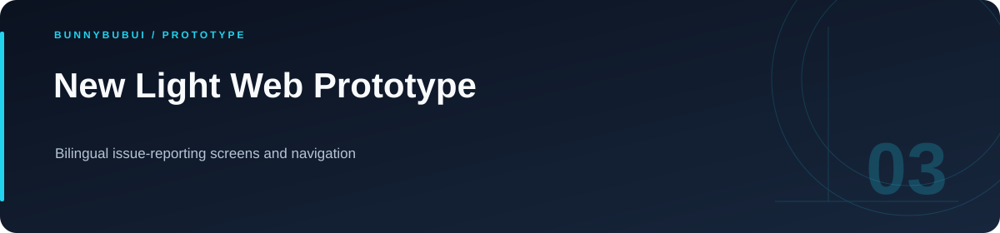

<p align="center">
  
</p>

<h1 align="center">New Light Web Prototype</h1>

<p align="center">Bilingual issue-reporting screens and navigation</p>

<p align="center">
     
</p>

<p align="center"><a href="#overview">ภาพรวม</a> · <a href="#features">ความสามารถ</a> · <a href="#start">เริ่มใช้งาน</a> · <a href="#structure">โครงสร้าง</a> · <a href="#validation">ตรวจสอบงาน</a></p>

<a id="overview"></a>

## ภาพรวม

ต้นแบบเว็บไซต์ New Light รวมหน้ารายงานปัญหา ความต้องการ และการติดตามสถานะ พร้อมส่วนติดต่อภาษาไทยและอังกฤษ เหมาะสำหรับดูการจัดหน้าและลำดับการใช้งานฝั่ง frontend

<a id="features"></a>

## ความสามารถที่มีใน source

| ส่วนงาน | รายละเอียด | อ้างอิง |
|---|---|---|
| **รายงานปัญหา** | แบบฟอร์มและหน้าติดตามสถานะ | [ดู source](report/) |
| **ความต้องการ** | หน้ารับข้อมูลและการนำทาง | [ดู source](needed/) |
| **ภาษา** | สลับข้อความไทย–อังกฤษในหน้าเว็บ | [ดู source](js/page_report.js) |

<a id="start"></a>

## เริ่มต้นใช้งาน

**สิ่งที่ต้องมี:** Python 3 สำหรับเปิดเว็บเซิร์ฟเวอร์ในเครื่อง

```sh
python3 -m http.server 8000
```

เปิด [หน้าเว็บในเครื่อง](http://localhost:8000/home.html)

<a id="structure"></a>

## โครงสร้างที่ควรเริ่มอ่าน

| ตำแหน่ง | หน้าที่ |
|---|---|
| [css/](css) | พื้นที่งาน / ไฟล์ประกอบ |
| [js/](js) | พื้นที่งาน / ไฟล์ประกอบ |
| [needed/](needed) | พื้นที่งาน / ไฟล์ประกอบ |
| [pictures/](pictures) | พื้นที่งาน / ไฟล์ประกอบ |
| [report/](report) | พื้นที่งาน / ไฟล์ประกอบ |

<a id="validation"></a>

## คำสั่งและผลตรวจ

repository นี้ไม่ได้กำหนดชุด automated tests สำหรับทุก flow; ตรวจผลจาก entry point และข้อมูลสาธิตที่เกี่ยวข้อง

<a id="scope"></a>

## ขอบเขตของงาน

หน้าล็อกอินเป็นการสาธิตการนำทาง ยังไม่ใช่การยืนยันตัวตนกับ server และการเปิดหน้าแบบฟอร์มไม่ได้ยืนยันว่ามีระบบจัดการเรื่องร้องเรียนครบวงจร

<a id="reading"></a>

## อ่านต่อ

- [บันทึกการเตรียม source](docs/CLEANUP.md)


---

<p align="center"><a href="https://github.com/BunnyBubui">BunnyBubui</a> · <a href="https://github.com/BunnyBubui/test">Software Portfolio</a></p>
